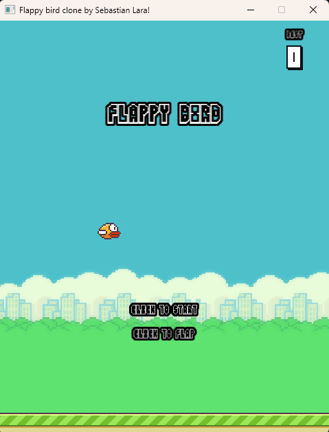
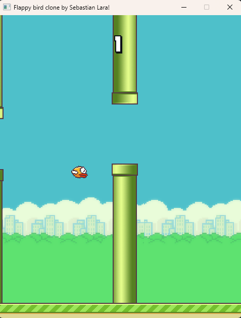
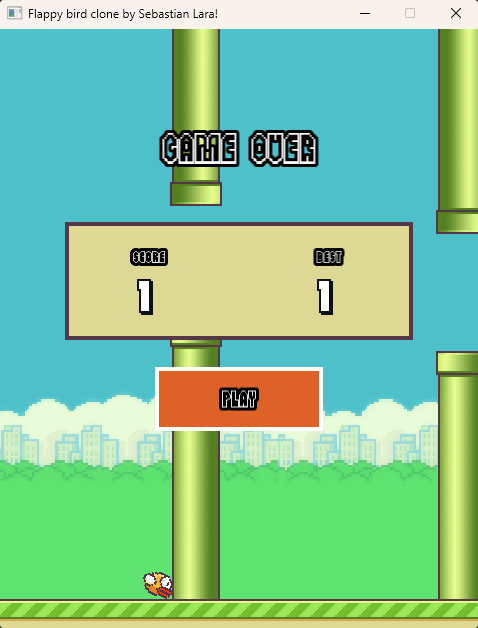
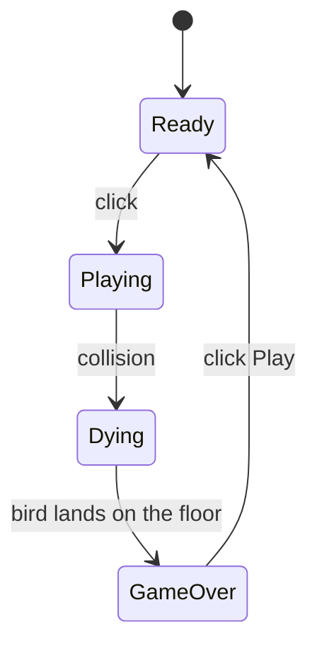
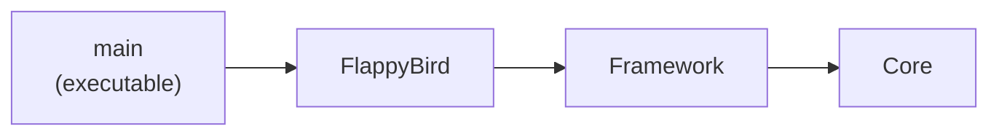

# Flappy Bird Clone

A Flappy Bird-inspired 2D game built with **C++20** and **SFML 3.1**.

It recreates the core Flappy Bird gameplay and doubles as a practical exercise in modern C++, the Standard Library, SFML, CMake, and the design of a small reusable 2D game framework that is kept separate from the game itself.

> Fan-made educational project. It is not affiliated with, or endorsed by, the creator of the original Flappy Bird.

**Project status:** Completed  
**Platform:** Windows  
**Compiler:** MSVC

## Screenshots

| Start screen | Gameplay | Game Over |
|---|---|---|
|  |  |  |

## Overview

| | |
|---|---|
| Language | C++20 |
| Graphics and audio | SFML 3.1.0 (static libraries) |
| Debug tools | Dear ImGui 1.91.9b with ImGui-SFML 3.0 (debug panel and hitbox overlay in Debug builds) |
| Build system | CMake 3.28 or newer, dependencies fetched with `FetchContent` |
| Project layout | Three CMake libraries (`Core`, `Framework`, `FlappyBird`) and one executable (`main`) |
| Compiler | MSVC |
| Platform tested | Windows |
| Window | 480 × 600, not resizable, 60 FPS limit |

## Gameplay

Control a bird and fly through the gaps between pairs of pipes without hitting them or the ground. The bird is affected by gravity and flaps upward when the player clicks the left mouse button.

The goal is to survive as long as possible and beat your best score. Each pipe pair passed awards one point. After a collision, the bird falls to the ground and the Game Over screen shows the current score next to the saved best score.

### Controls

| Action | Input |
|---|---|
| Start the game | Left mouse button |
| Flap while playing | Left mouse button |
| Restart after Game Over | Click the **Play** button |
| Close the game | Close the window |

The first click on the start screen both starts the game and makes the bird flap. The **Play** button returns to the start screen with a fresh game; one more click begins the run.

### Game flow



| State | What is shown | What moves |
|---|---|---|
| `Ready` | Title, instructions and best score (top right) | Background, floor, and a bird that floats up and down with the title |
| `Playing` | Current score | Everything |
| `Dying` | Current score | Only the bird, falling to the floor. Input is ignored |
| `GameOver` | "Game Over", score, best score and the Play button | Nothing |

## Features

- Bird movement driven by gravity and upward flap impulses.
- Animated bird wings and a rotation that follows the vertical movement.
- Three pipe pairs that scroll across the screen and are recycled with randomized vertical positions. They are spaced so that at most two are visible at once.
- Collision detection between the bird, the pipes, and the ground.
- Score tracking and a persistent best score saved locally in `topScore.dat`.
- Four game states (`Ready`, `Playing`, `Dying`, `GameOver`) and a restart flow that resets the bird, score, pipe positions, and obstacle tracking.
- Continuously scrolling background (20 px/s) and floor (120 px/s) that move at different speeds to create a parallax-like effect.
- Start screen, in-game HUD, and Game Over screen.
- Sound effects for flapping, scoring, hitting something, falling after crashing into a pipe, and restarting.
- Debug-only controls for tweaking gameplay values and visualizing sprite bounds and collision hitboxes.

## Architecture

The code is split into a small, game-agnostic framework and the gameplay that is specific to Flappy Bird. Each part is its own CMake target, and dependencies only point in one direction.



| Module | Type | Contents | Knows about Flappy Bird? |
|---|---|---|---|
| `Core` | Header-only (`INTERFACE`) | `Types.hpp` (fixed-width type aliases), `Math.hpp` (`Random`), and the compile definitions and flags shared by every target | No |
| `Framework` | Static library | `Entity`, `World`, `UIElement`, `UIScreen`, `Application` / `App<TWorld>`, `RenderOrder` | No |
| `FlappyBird` | Static library | Everything in the `FlappyBirdGame` namespace: bird, floor, background, pipes, score, sound, UI widgets and screens, and the game world | Yes |
| `main` | Executable | `src/main.cpp`: creates the window and runs `App<FlappyBirdGame::World>` | |

The framework never includes a header from the game. The game world derives from the framework's `World`, and the framework only sees it through that base class.

### Framework layer

- **`Application` and `App<TWorld>`**: `Application` owns the main loop, the ImGui integration, and the active world. `App<TWorld>` is a thin template on top of it that creates the world of the requested type. It can also replace the world (`ChangeLevel`), although this game restarts in place.
- **`World`**: owns entities and UI screens, updates them, and coordinates rendering. Entities are created with `Add<T>()` and screens with `AddScreen<T>()`.
- **`Entity`**: an abstract base for updateable objects with a sprite and a render priority. `World::Add<T>()` centers their origin automatically.
- **`UIElement` and `UIScreen`**: a minimal interface layer. A screen is a group of elements that is shown, hidden, updated, and drawn as a whole.
- **`Random`** (in `Core`): a small random-number helper built on `std::mt19937_64` seeded from `std::random_device`.

### Build conventions

- **`GAME_DEBUG` / `GAME_RELEASE`** are defined from the build configuration (`Core` propagates them to every target). Debug-only code, such as the ImGui panel and the hitbox overlay, is wrapped in `#ifdef GAME_DEBUG`.
- **Precompiled header**: `Framework/include/PCH.hpp` is precompiled for the framework and for the targets that depend on it. Every header still includes what it uses, so none of them depends on the precompiled header to compile.
- **`SFML_STATIC`** and C++20 are also set once, in `Core`.

## Technical Highlights

### Depth-based rendering

Entities (and extra sprites such as the pipes of a pair) carry a render priority. Each frame the world gathers the drawable sprites, sorts them with `std::stable_sort`, and draws them in order; a larger value means farther back. The UI is drawn afterwards in screen space with the default view, so it never depends on a camera. In Debug builds, the hitbox overlay and the ImGui panel are drawn after that.

### Time-based updates

The game loop measures elapsed time and passes `deltaTime` to every update. Bird physics (gravity 900 px/s², flap impulse −300 px/s, maximum fall speed 600 px/s), scrolling, and animations are expressed in units per second instead of per frame.

### Obstacles

Three pipe pairs are spaced by `(windowWidth + pipeWidth) / 2`, which guarantees that at most two are on screen while the third waits just outside the right edge. When a pair leaves the left edge it jumps ahead by `3 × spacing` (the length of the whole loop) and receives new random heights. Moving by a fixed distance, instead of snapping to a fixed X position, keeps the spacing exact regardless of frame time.

### Collisions and hitboxes

The bird uses its own hitbox: an unrotated rectangle centered on the bird at 75% × 70% of the 34 × 24 sprite. The sprite's own bounds are not used because they grow when the sprite rotates (at 35° they are roughly 42 × 39 px) and would register hits on pipes the bird visually does not touch. Pipes and the floor use their sprite bounds. The hitbox scale can be tuned live from the debug panel.

### Resting on the floor

After a crash the bird has to stop with its visible pixels touching the floor. The bounds of a rotated sprite include transparent corners, which leaves the bird floating a few pixels above the ground. Instead, `Bird::GetLowestVisibleOffset()` computes the lowest *opaque* pixel of the current animation frame (rotated the same way the sprite is rotated), and the bird is placed so that this pixel sits exactly on the floor.

### Game states and UI

Game logic is organized as an `EGameState` state machine in the game world. `SetState()` is the single place that decides which UI screen is visible, and each state updates only what it needs (for example, `Dying` updates only the bird). The UI follows the same convention as the entities: every element is positioned by its center. The score is drawn with a digit spritesheet, while the other texts and the Play button use `sf::Text` with a font.

### Audio

`SFXManager` stores each sound effect (buffer plus sound) in a `std::unordered_map` keyed by name, so gameplay code simply calls `Play("SCORE")`. The wing sound belongs to the bird itself. A failed load is reported on `stderr` and the sound is skipped.

### Best score persistence

`ScoreManager` keeps the current and best score. The best score is stored as a plain-text number in `topScore.dat` in the working directory, and it is written when a run ends with a new record.

### C++ and Standard Library

- Templates and `static_assert` for type-safe creation (`App<TWorld>`, `World::Add<T>()`, `World::AddScreen<T>()`, `UIScreen::Add<T>()`).
- `std::unique_ptr` for owned entities, screens, and sound resources.
- `std::vector`, `std::array`, and `std::unordered_map` for entities, obstacle pairs, and sounds.
- `std::stable_sort`, `std::clamp`, and `std::lerp` for render ordering, velocity limits, and rotation smoothing.
- `<random>` for the pipe heights.
- `constexpr` constants, enum classes, forward declarations, and `[[nodiscard]]` getters.

### Debugging tools

In Debug builds, Dear ImGui and ImGui-SFML provide a panel to adjust the pipe offsets, re-randomize a pipe pair, toggle the bird's vertical movement, change the bird's hitbox scale, and show the hitboxes and sprite bounds as an overlay. Release builds draw none of this.

## Project Structure

```text
.
├── CMakeLists.txt          # FetchContent, executable, Windows subsystem, asset copy
├── CMakePresets.json       # x64-Debug and x64-Release (Ninja)
├── README.md
├── Core/
│   ├── CMakeLists.txt
│   └── include/            # Types.hpp, Math.hpp
├── Framework/
│   ├── CMakeLists.txt
│   ├── include/            # Application, Entity, PCH, RenderOrder, UIElement, UIScreen, World
│   └── src/                # Application, Entity, UIScreen, World
├── FlappyBird/
│   ├── CMakeLists.txt
│   ├── include/            # one header per class
│   └── src/                # the matching .cpp files
├── src/
│   └── main.cpp
└── Assets/
```

The game classes (all in the `FlappyBirdGame` namespace):

| Class | Role |
|---|---|
| `World` (`FlappyBirdWorld.hpp`) | State machine, collisions, scoring, restart, debug tools. Its file name differs from the framework's `World.hpp` so the two never clash |
| `Bird`, `Floor`, `Background`, `ObstaclePair` | Entities |
| `SFXManager`, `ScoreManager` | Sound effects by name; current and persistent best score |
| `ScoreNumber`, `LabelElement`, `PanelElement`, `ButtonElement` | UI widgets |
| `HUDScreen`, `StartScreen`, `GameOverScreen` | UI screens |

## Assets

The game expects these files in the `Assets/` folder:

| Asset | Used for |
|---|---|
| `background-day.png` | Looping background |
| `base.png` | Scrolling floor |
| `pipe-green.png` | Pipes |
| `spritesheetYellow.png` | Bird animation frames (34 × 24 px each) |
| `bluebird-midflap.png` | Helper sprite used as the pivot of each pipe pair (drawn fully transparent) |
| `score_numbers_spritesheet.png` | Digits 0–9 for the score (24 × 36 px each) |
| `FlappyBirdy.ttf` | Text of the start and Game Over screens (path set in `FlappyBird/src/LabelElement.cpp`) |
| `sfx_wing.wav`, `sfx_point.wav`, `sfx_hit.wav`, `sfx_die.wav`, `sfx_swooshing.wav` | Flap, score, hit, crash, and restart sounds |

Missing textures, the font, or the wing sound stop the game at startup with an error. The score, hit, crash, and restart sounds are skipped instead, with a message on `stderr`.

### Asset licensing

The assets are third-party files and are **not** covered by this project's MIT license. In particular, the UI font **FlappyBirdy** by "GeronimoFonts" ([FontStruct](http://fontstruct.com/fontstructions/show/1026901)) is released under an *All Rights Reserved* license; see `Assets/license.txt` and its FontStruct page for the terms. If you fork or redistribute this repository, make sure you are allowed to redistribute each asset, or replace them with your own.

## Build and Run

### Requirements

- Windows
- CMake 3.28 or newer
- A compatible MSVC C++ toolchain with C++20 support
- Git and an Internet connection, so CMake can download the dependencies during configuration

CMake uses `FetchContent` to retrieve SFML 3.1.0, Dear ImGui, and ImGui-SFML, and builds them as static libraries. A post-build step copies the `Assets` folder next to the executable.

### Build with the presets

The presets use the Ninja generator, so run these commands from a Visual Studio *Developer PowerShell* (or open the folder directly in Visual Studio, which handles the environment for you):

```powershell
git clone https://github.com/<YOUR-USERNAME>/<REPOSITORY-NAME>.git
cd <REPOSITORY-NAME>
cmake --preset x64-Release
cmake --build out/build/x64-Release
```

Replace `<YOUR-USERNAME>` and `<REPOSITORY-NAME>` with the actual repository URL and folder name. Use `x64-Debug` instead to get the debug tools. The executable is generated at:

```text
out/build/x64-Release/bin/main.exe
```

### Build with a Visual Studio generator

```powershell
cmake -S . -B build
cmake --build build --config Release
```

The executable is then at `build/bin/Release/main.exe`.

### Debug and Release builds

| | Debug | Release |
|---|---|---|
| Debug panel and hitbox overlay | Yes | No |
| Console window (log messages) | Yes | No, the game runs as a Windows application |

### Run

Run the executable from the folder that contains it, so the relative `Assets` paths resolve correctly. `topScore.dat` is created in that same folder the first time you set a record.

### Troubleshooting

- **The game closes immediately or reports a missing file.** The working directory does not contain `Assets/`. Start the game from the executable's folder.
- **Running from Visual Studio's CMake integration.** Set the working directory in `launch.vs.json` so the assets are found:

  ```json
  "currentDir": "${targetDir}"
  ```

## Testing and Validation

The game has been manually tested on Windows during development, including:

- Starting and playing a game.
- Bird flap input and movement.
- Pipe recycling and obstacle collisions.
- Ground collision and the full Game Over flow.
- Score increments and best-score persistence across launches.
- Restarting a game and checking that the gameplay state is reset.
- Sound-effect playback.

An automated test suite is not currently included. Other platforms and compilers have not been officially tested.

## Known Limitations and Ideas

- The framework is a static library inside this repository; it is not packaged for use from other projects.
- Asset paths are relative to the working directory instead of the executable's location.
- The window size is fixed, and the best score is stored as editable plain text.
- Possible additions: a "new record" indicator, medals, volume controls, and a menu with settings.

## License and Credits

Created by Sebastian Lara.

The project's original source code is released under the [MIT License](LICENSE). Attribution is appreciated. See [Asset licensing](#asset-licensing) for the files in `Assets/`.

Built with [SFML](https://www.sfml-dev.org/), [Dear ImGui](https://github.com/ocornut/imgui), and [ImGui-SFML](https://github.com/SFML/imgui-sfml).
